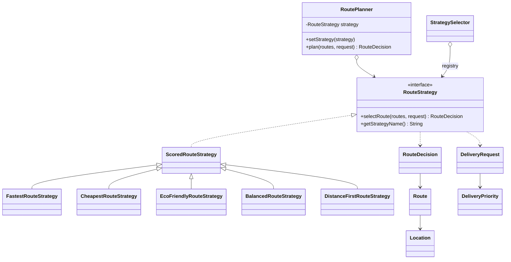
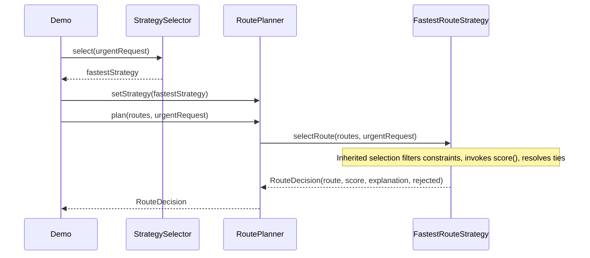

# Smart Delivery and Route Optimization Engine

Java Strategy Pattern implementation for Assignment 5. Eight candidate routes connect a warehouse and hospital. The engine chooses an eligible route and explains the selection. All sample measurements are synthetic; costs use KZT, distances km, time minutes, emissions kg CO2.

## Architecture and defense answers

`RoutePlanner` is the Context. It holds a `RouteStrategy` and only delegates `plan`; it never inspects strategy types or algorithm names. `RouteStrategy` is the Strategy interface. Its result is a `RouteDecision` rather than only a route so explanations and rejection reasons travel with the answer.

`FastestRouteStrategy`, `CheapestRouteStrategy`, `EcoFriendlyRouteStrategy`, `BalancedRouteStrategy`, and `DistanceFirstRouteStrategy` are Concrete Strategies. `ScoredRouteStrategy` shares hard-constraint filtering and deterministic ranking. Each concrete class supplies its scoring algorithm. The interface keeps alternative future implementations possible without inheriting the base class.

Strategy solves the need to exchange route optimization algorithms without growing conditional branches in the planner. `Demo` changes the same planner from fastest to cheapest to eco to balanced to distance-first: four runtime switches. Its first loop also compares all strategies using the exact same request. Its second loop demonstrates different business priorities.

`StrategySelector` chooses **which** strategy should run; each strategy decides **how** to rank routes. A configurable map registers business priorities, with a small rule allowing STANDARD requests to prefer eco. URGENT always retains urgency. Adding a new algorithm requires one class and demo/registration wiring, with no planner changes; commit 5 demonstrates distance-first.

Strategy varies one behavior behind a context interface. Bridge separates two independently varying class hierarchies (such as notification type and delivery channel). This engine has interchangeable optimization behavior rather than two independent hierarchies.

SRP separates domain data, planning, business selection, and scoring. OCP is demonstrated by the fifth strategy. DIP is demonstrated by `RoutePlanner` depending only on `RouteStrategy`. Composition and immutable records keep the model easy to reason about.

## Formulas and constraints

- Final time = estimated minutes + traffic penalty + weather penalty. Fastest minimizes this total, so base time alone cannot decide the winner.
- Total cost = base cost + distance × 50 + additional fees + 500 for URGENT (otherwise 0). Cheapest minimizes the total. This shared domain calculation is also used by every strategy's budget check.
- Eco score = carbon emission × 0.8 + distance × 0.2. The coefficients are illustrative policy coefficients with appropriate reciprocal units, not empirical emissions estimates. This tradeoff belongs to the eco strategy because it is an optimization policy, not a planner responsibility.
- Balanced score = sum of weight × normalized metric for time, total cost, distance and emissions. Normalization is `(value - min) / (max - min)` over **eligible routes only**. Equal-valued criteria contribute zero. Default weights are 0.4, 0.3, 0.1, 0.2. All weights must be finite and nonnegative, and sum to 1 within 1e-9.
- Distance-first minimizes kilometers after exactly the same constraints.

Unavailable routes, routes over the budget, routes after the deadline, and routes above the emissions limit are rejected before scoring. Exact boundaries are allowed. All violated constraints are recorded. Equal scores are resolved by lexicographic route id, independent of input order. Duplicate ids are rejected. No suitable route, including an empty input, raises `NoSuitableRouteException`; null input and invalid domain measurements are explicitly rejected.

For the STANDARD demo request (budget 6000, deadline 60, emissions 20), fastest selects B, cheapest D, eco E, and distance-first E. With a budget of 2000, fastest changes to D. Tests also demonstrate deadline and emissions limits changing the result.

## Limitations

This selects among precomputed routes; it does not solve a road graph shortest-path problem. Traffic and emissions are provided estimates. Monetary calculations use doubles for coursework rather than production decimal money types. Min-max normalization depends on the candidate set. Shared base-class filtering is a convention for new implementations; an independent RouteStrategy implementation must uphold those constraints itself. Balanced ranking recomputes bounds while comparing candidates and could cache them for a larger dataset.

## UML class diagram



## UML sequence diagram



## Defense exercise

Add a `SafestRouteStrategy`: introduce a validated risk metric in Route, implement scoring, register it for comparison, add a test proving constraints still apply, and run the suite. Explain why the existing planner remains unchanged.

## Build and run

Requires JDK 17 or newer. From the repository directory:

```sh
./run.sh
./test.sh
```

The test script needs curl and internet on its first run to download JUnit from Maven Central. Alternatively, open `pom.xml` in IntelliJ IDEA as a Maven project and run `Demo`, or use `mvn test` with Maven 3.9+. There are no production dependencies.

## Verification

**24/24 JUnit 5 tests passed**, compiled with `javac --release 17` and executed on JDK 25. The Java 17 API target is verified; a separate JDK 17 runtime was not used locally. Full [test results](docs/test-results.txt) and actual [console output](docs/demo-output.txt) are included.

## Development history

Seven meaningful commits track domain/contracts, core operations, integration, a separate extension, tests, and documentation. The supplied assignment asks for at least eight; this repository follows the requested seven-commit limit and therefore does not satisfy that particular rubric item. Commit dates are actual development dates.
